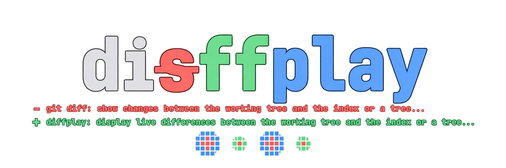

## Quickstart

```sh
curl -fsSL https://raw.githubusercontent.com/isaiash/diffplay/main/quickinstall.sh | bash
```

The installer detects your OS, installs missing dependencies (may require sudo or Homebrew), and downloads a temporary Go toolchain when needed.
The binary is installed to `~/.local/bin` by default; make sure that directory is on your `PATH`:

```sh
export PATH="$HOME/.local/bin:$PATH"
```

### From source

With Go 1.24+ and Git installed, run this from a checkout:

```sh
./install.sh
```

## Usage

```sh
diffplay                      # List + diff above, graph below.
diffplay /path/to/repository   # Watch another repository.
diffplay --view list           # Full-screen list.
diffplay --view graph          # Full-screen graph.
```

| Action | Control |
| --- | --- |
| Switch views / quit | `Tab` / `q` |
| Navigate files / folders | `↑↓` / `←→` |
| Inspect a graph file | Hover or `n` / `p` |
| Scroll the diff | `J` / `K` (`j` / `k` in graph view) |
| Resize panes | Drag a divider |
| Pan / zoom / reset graph | Drag / wheel or `+` / `−` / `r` |
| Copy diff text | Drag inside the diff; release to copy via OSC 52 |

- **Colors:** blue = new, green = edited, red = removed; white = selected.
- **List:** `HITS` counts observed edits; `%` is `(added + removed) / current file lines`. Unknown files (such as binary assets) keep `?` on their row but are excluded from header totals and the diff bar.
- **Header:** cumulative additions/removals and net growth; the bar shows diffs only.
- **Graph:** the split view shows changed files only; full-screen adds quiet context. Single-child folder chains share a frame (`a/b/`); branches stay separate. Frames are gray, with only the selected file's ancestors in white.
- **Monitoring:** loads existing Git changes, then follows live edits with HEAD-relative previews at every depth. Git ignores are respected. Opening a parent directory offers a repository picker.
- **Large diffs:** the preview reads only the visible window from a private disk-backed snapshot. Current bounds: 8 MiB per captured text file and 128 MiB per generated diff; individual lines over 16 KiB are clipped.

Copying requires terminal permission for OSC 52. Your system copy shortcuts are not changed. Polling can miss edits between scans; `HITS` resets after commit or reversion. A truecolor terminal is recommended.

## Development

```sh
make test
make build
make smoke
./bin/diffplay
```

## License

[MIT](LICENSE)
